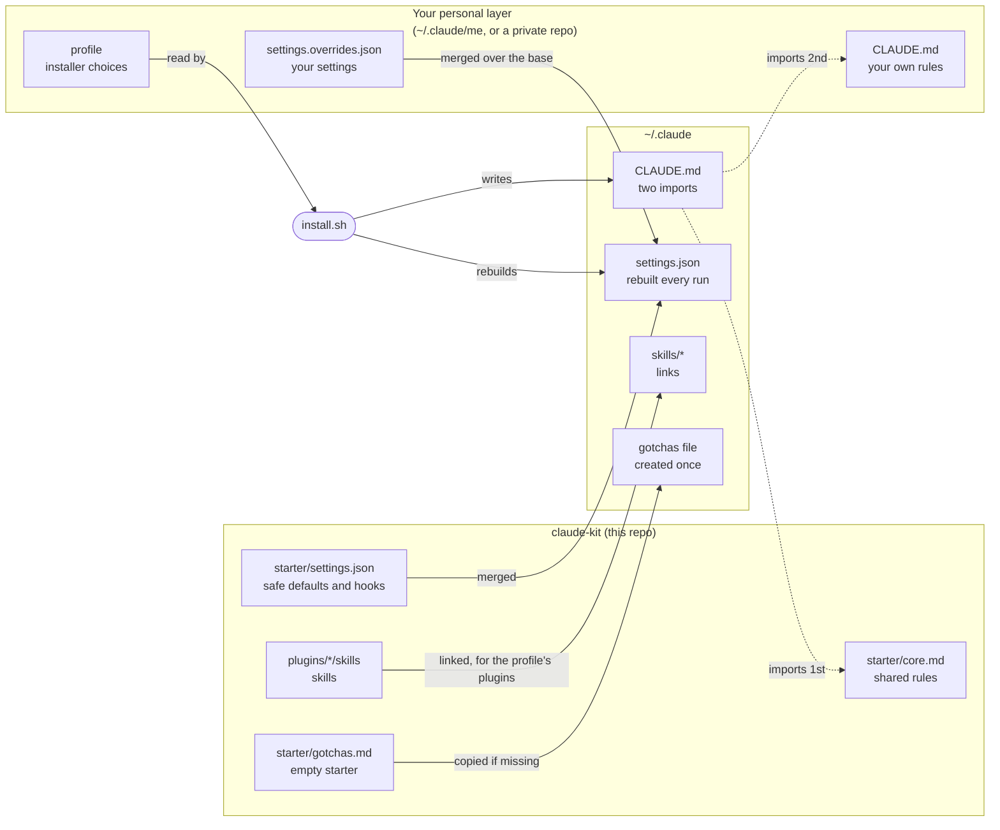

# claude-kit

claude-kit keeps your [Claude Code](https://code.claude.com) setup current and makes it shareable. Claude Code, claude.ai and the Claude platform change quickly, and so do the best ways to use them, so a setup kept by hand falls behind and stays on one computer. The kit writes the setup down as files: shared working rules, cautious default settings and skills, which one installer applies to `~/.claude`. To stay current, you pull the kit and rerun the installer. To share it, the general part is this public kit, which anyone can install, and your own rules and settings live in a personal layer that the setup never changes without your approval and that you can keep in a private repo and carry to another computer. Every feature the kit ships must add value beyond what Claude Code does out of the box.

Claude Code is the version of Claude that works with the files on your computer. The kit gives Claude a short set of working rules, cautious default settings, and skills for starting tasks, keeping one session as your chief of staff, checking changes before they ship, and logging what slows you down. It works whether or not you keep your work in git, and you can set it up without opening a terminal.

## Getting started

There are two ways in. Both write the same files, so you can start on one and switch to the other later.

| | Guided | Terminal |
|---|---|---|
| **For** | Anyone, including people who have never opened a terminal | People comfortable with a shell and git |
| **How it goes** | You answer a few questions inside Claude Code; it shows you what it would write, and writes only when you say yes | You clone the kit and run `install.sh` |
| **You need** | Claude Code. On a Mac, the setup helps you get Apple's free developer tools, which it needs; on Linux, `python3` and, for the desktop app, `git` | Claude Code, `git` and `python3` |

### The guided route

1. **Get Claude Code.** If you don't use a terminal, get the desktop app: the [quickstart](https://code.claude.com/docs/en/quickstart) has the download and says which Claude plans include Claude Code. Open the app and sign in with your Claude account. Claude Code is in the app's **Code** tab.
2. **Add the kit.** In the Code tab, start a new session (a session is one conversation; earlier ones stay listed in the app), then type each line below into the message box exactly as shown, starting with the `/`, and press Return after each:

   ```
   /plugin marketplace add mihiarc/claude-kit
   /plugin install kit-setup@claude-kit
   ```

   The first line tells Claude Code where the kit is; the second installs its setup skill (a skill is a set of instructions Claude follows for one kind of job). Claude Code replies to each line. If it answers the `/plugin` lines as ordinary chat instead of acting on them, this route won't work in your version of the app; ask someone comfortable with a terminal to help with the terminal route below.
3. **Start a new session and ask for the setup.** Claude Code picks up a newly installed skill in a new session. Start one, then type `set up the kit` and press Return. (The skill's command, `/kit-setup:kit-setup`, does the same; a plugin's commands are named `<plugin>:<skill>`, which is why the name appears twice.)

   If a window appears asking to install Apple's command line developer tools, click Install and wait for it to finish. The setup needs `python3`, which comes with those tools, and it tells you when to carry on.
4. **Answer the questions.** It asks, one at a time, what you use Claude for, whether you keep your work in git (if you don't, each task gets a plain folder), where documents for you should go, what must stay private, and how you like drafts written. Each question has a suggested answer, and any of them can be skipped and answered later. Last, it offers the extras one at a time, each optional: a status line (a line under the message box showing the session's name, how full its memory is, and how much of your usage limits is left), session names, and Docket (a page in your browser listing what's waiting on you).
5. **Read the preview, then say yes.** It shows your new `CLAUDE.md` (the file of your own rules and details that Claude reads every session), the settings in plain words, and every file it would create or replace. Nothing is written until you say yes; if you say stop, nothing has changed.
6. **Start a new session** so Claude reads your new files, and try "start a task on my grant application" (or whatever you're working on).

Run the setup again any time to change an answer, or edit your own `CLAUDE.md` (`~/.claude/me/CLAUDE.md`) directly. That's the whole guided route; the rest of this page is reference.

In the desktop app, the setup may ask to download its own copy of the kit. That is expected: it can't reach the copy from step 2 from inside the app, so it downloads one with git and runs git for you. On a Mac, git comes with the same developer tools as `python3`; on Linux, install `git` first if you don't have it.

### The terminal route

1. **Clone the kit** to a folder whose path has no spaces:

   ```sh
   git clone https://github.com/mihiarc/claude-kit ~/src/claude-kit
   ```

2. **Preview, then install:**

   ```sh
   ~/src/claude-kit/install.sh --dry-run   # say what would change, and change nothing
   ~/src/claude-kit/install.sh
   ```

   With no profile, the first run uses the defaults: your own folder at `~/.claude/me`, the skills of start-task, chief-of-staff, verify-setup and papercuts, and your login shell (zsh or bash). It leaves two files there for you to edit:
   - **`~/.claude/me/CLAUDE.md`**, from [`starter/personal.md.template`](starter/personal.md.template): replace each `<placeholder>`, delete the sections you don't use, and delete the HTML comments when you're done. If you already had a `~/.claude/CLAUDE.md` of your own, your rules are moved here instead.
   - **`~/.claude/me/profile`**, every setting commented out at its default. Uncomment a line to change it: `plugins` (names, or `all`), `shell`, `gotchas`, `papercuts` (your papercut log, created on the next run; name the same path in your `CLAUDE.md`), and `repos` with `repos_dir` (a file listing one `owner/repo` per line, cloned into that folder). [`installer/README.md`](installer/README.md) describes each one.

3. **Run `install.sh` again** after editing. It applies what you changed and leaves everything else as it is, so it is safe to rerun any time. Then open a new terminal (from now on, `claude` names each session after its repo or folder) and start a new Claude Code session.

Options: `--profile <path>` uses a profile kept elsewhere, `--skip-repos` skips cloning the profile's repos, and `--help` lists them.

**Changing settings.** The installer rebuilds `~/.claude/settings.json` on every run, so put your own settings in `~/.claude/me/settings.overrides.json`, which is merged over the kit's defaults. A setting Claude Code wrote into `settings.json` itself (from `/config`, or a `/plugin install`) is listed by the run so you can move it into your overrides. The merge rules are in [`installer/README.md`](installer/README.md#settings-overrides).

### Switching routes, rerunning, a second computer

- **Guided to terminal.** Clone the kit and run the clone's `install.sh`; it reads the profile the guided setup left in `~/.claude/me`. If that profile has a live `kit =` line naming another copy of the kit, the installer stops and says so: change the line to the clone's path and run it again.
- **Terminal to guided.** Install kit-setup with `/plugin` as in the guided route and run it. It starts from your existing files and asks only what you want to change.
- **A second computer.** Keep `~/.claude/me` in a private git repo (the guided setup offers to make one). On the other computer, clone it to `~/.claude/me` and install the kit; the installer finds your profile there.

## What the setup writes

Whichever route you take, you get the same files, most of them in `~/.claude`, the folder Claude Code reads at the start of every session. The kit and your personal layer are the two sources; the installer reads your profile and builds `~/.claude` from both:



- **`~/.claude/CLAUDE.md`**: two import lines that load the kit's shared rules (`starter/core.md`) and then your own.
- **Your own `CLAUDE.md`**, in a folder of your own (`~/.claude/me` by default), where you write who you are, where your files live, what stays private and how you write. Several skills read it (see [What each skill reads from your CLAUDE.md](#what-each-skill-reads-from-your-claudemd)). The folder also holds your `profile` (the installer's choices) and, if you have one, `settings.overrides.json`. `install.sh` never overwrites them (it creates your `CLAUDE.md` and profile only when they're missing); the guided setup replaces them only with the version you approved in its preview, backing up the old one first. You can keep this folder in a private repo to use it on a second computer.
- **`~/.claude/settings.json`**, built from the kit's [safe defaults](#safe-defaults) plus any changes you ask for.
- **The kit's skills**, linked into `~/.claude/skills`, so they run under their plain names (`/start-task`) and an update to the kit reaches them at once.
- **`~/.claude/gotchas.md`**, an empty file for settled answers to tooling problems, and your papercut log if you name one. Neither is ever overwritten.
- **Outside `~/.claude`:** one line in `~/.zshrc` or `~/.bashrc` (unless you choose no shell) that loads the session names and `kit-secret`, and four entries in git's global ignore file (`CLAUDE.local.md`, `**/.claude/settings.local.json`, `.playwright-mcp/` and `.claude/worktrees/`) so per-person files never get committed.

Any file that is replaced is first moved aside as `<file>.bak-<timestamp>`, so nothing you had is lost.

## Safe defaults

The kit's base settings ([`starter/settings.json`](starter/settings.json)) start cautious, and you loosen them only on purpose:

- **Nothing is pre-approved.** There are no allow rules, so Claude asks before `git push` and `gh pr merge` as it would without the kit.
- **Outbound actions ask first.** Pushes that force or delete, and connected tools that send, share, forward or trash, always ask, even if you add allow rules later.
- **No model, effort or permission mode is set**, so Claude Code's own defaults apply until you choose.
- **The hooks stay quiet.** The gotcha hook says something only when a command or error matches a line in your gotchas file, which starts empty. The stacked-PR guard does nothing without the GitHub CLI (`gh`). Both do nothing if their script is missing.

## Platforms

The kit is developed and tested on macOS. The installer's tests also run its bash setup, and the plugins have Linux fallbacks (the disk-cleanup commands, the PDF builder's Chrome path, the default browser for Docket), but no one has run the whole kit on Linux yet. Docket's Attach button drives macOS's Terminal app, so it appears only on macOS. `kit-secret` uses the macOS keychain, or `secret-tool` on Linux. Windows is untested.

## Plugins

| Plugin | Kind | What it does |
|---|---|---|
| [kit-setup](plugins/kit-setup) | skill | Guided setup of the kit from inside Claude Code, no terminal needed: interviews you, shows the `CLAUDE.md` and settings it would write, writes them only on your yes through the kit's installer, backs up what it replaces, and offers the extras. |
| [start-task](plugins/start-task) | skill | Starts a task in a fresh Claude session: sizes it, settles open decisions with you, and writes its opening progress record (goal, what is settled, the checks that define done, what is out of scope) where the new session loads it. Tasks in a git repo get a worktree; other tasks get a plain folder. |
| [chief-of-staff](plugins/chief-of-staff) | skill | Runs one chief-of-staff session across all your projects: it interviews you on the questions waiting on you, settles what your recorded decisions already answer, dispatches tasks to background sessions and steers them by message. Includes Docket, a local task board (waiting on you, waiting on others, someday, done) to filter, move and answer the waiting items from. |
| [verify-setup](plugins/verify-setup) | skill | Writes a repo's own `verify` skill, how to check a change there end to end, from the repo's real commands, running each one before writing it down. |
| [papercuts](plugins/papercuts) | skill + hook | A sweep skill that triages a papercut log into gotchas, repo PRs you pick and open decisions, and a hook that hands a session the one gotcha line its command or error needs. |
| [stacked-pr-guard](plugins/stacked-pr-guard) | hook | Blocks `gh pr merge --delete-branch` and `git push --delete` when open PRs are based on the branch, since GitHub closes those PRs instead of retargeting them. |
| [human-handoff](plugins/human-handoff) | skill | Packages finished work for a human collaborator and drafts the covering note; sends only on your word. |
| [codebase-audit](plugins/codebase-audit) | skill | A full critical review of a codebase or component, with severity-rated findings checked against current best practice and filed as GitHub issues once you confirm. |
| [residue-sweep](plugins/residue-sweep) | skill | Removes development residue (history-narrating comments, stale names, dead code, doc drift) without changing behavior. |
| [disk-cleanup-inventory](plugins/disk-cleanup-inventory) | skill | A tiered inventory of what is using disk space, delivered as a checklist worksheet; deletes only what you tick. |
| [downloads-tidy](plugins/downloads-tidy) | skill | Files and declutters `~/Downloads` against your own filing rules and existing folders, leaving it flat. |
| [speaker-prep](plugins/speaker-prep) | skill | Turns a deck or brief into talking points or a timed script, with print-ready PDFs. |
| [visual-inventory](plugins/visual-inventory) | skill | Report pages read at a glance: an items × checks grid on a fixed five-status scale, findings by kind, the top five and per-item detail, rendered from one JSON file into one self-contained HTML page. [Example](plugins/visual-inventory/skills/visual-inventory/assets/example.html). |

The installer links start-task, chief-of-staff, verify-setup and papercuts by default; set `plugins = all`, or name the ones you want, in your profile (kit-setup asks).

**Just one plugin, without the setup.** Any plugin can also be installed on its own with `/plugin install <name>@claude-kit` after adding the marketplace. Skills installed that way are namespaced (`/start-task:start-task`), they don't get the kit's shared rules, and the skills below that read your `CLAUDE.md` will ask you for what it would have told them. If you later run the setup, it lists the plugins installed both ways so you can remove the duplicate.

## What each skill reads from your CLAUDE.md

Your own `CLAUDE.md` is where skills find your specifics. Each skill works without them, using the default shown or asking you, but works best once they're written down. The kit's shared rules ([`starter/core.md`](starter/core.md)) also read it for where your papercut log and gotchas file are, where documents for you go, and how you launch sessions. The section names below are those of [`starter/personal.md.template`](starter/personal.md.template).

| Skill | What it reads from your `CLAUDE.md` | Without it |
|---|---|---|
| start-task | Whether you work in git (if not, every task gets a plain folder); where task folders go; where progress records go; any rule for choosing the model and effort; how you launch sessions | Asks whether a task uses git; task folders at `~/claude-tasks/<task>`; the record in the task folder's `CLAUDE.local.md` |
| chief-of-staff | Where the questions file lives; a launcher or viewer for it; which projects keep their questions in a shared tool; your drafting rules; your verification rules | `~/.claude/chief-of-staff/questions.md` |
| papercut-sweep | Where the papercut log and gotchas file are; where your repos live and their GitHub owners; what must never reach GitHub; your rules for commit and PR text; any command that records what a session is working on | Asks where the log is |
| human-handoff | Your rules for drafting in your voice; where the handoff tally goes | Tally at `~/.claude/human-handoff/tally.md` |
| downloads-tidy | Where your repos and datasets live, and any dataset that must never leave the computer (it also reads `~/Documents/CLAUDE.md` for your filing rules) | Asks where repos and datasets live |
| disk-cleanup-inventory | Where your repos, projects and datasets live | Asks, or starts from the largest folders |
| visual-inventory | Where report pages go, who opens them, and what must not appear in them | Saves the page in a folder named for its subject |
| verify-setup, codebase-audit, residue-sweep | Nothing of yours: they read the repo's own `CLAUDE.md` and README | |
| speaker-prep | Nothing | |
| kit-setup | Writes your `CLAUDE.md`; on a rerun it starts from the one you have | |

The gotcha hook reads no `CLAUDE.md`: it finds your gotchas file at `~/.claude/gotchas.md`, or wherever the `GOTCHAS_FILE` setting points.

## Extras

The installer and kit-setup set these up when you choose them. Without either, set them up by hand as below.

- **[Status line](extras/statusline/statusline.sh)** shows the session name, folder, branch, model and effort, plus context use against a token budget and the 5-hour and 7-day rate limits with a projection to reset. It needs `jq`. The kit's base settings turn it on; to set it by hand, point your `~/.claude/settings.json` at it:

  ```json
  "statusLine": {"type": "command", "command": "/path/to/claude-kit/extras/statusline/statusline.sh", "refreshInterval": 30}
  ```

  The budget (default 400K) and yellow threshold (250K) can be set with the `STATUSLINE_CONTEXT_BUDGET` and `STATUSLINE_CONTEXT_YELLOW` environment variables, e.g. in the `env` block of `settings.json`.

- **Session names** ([zsh](extras/zsh/claude-names.zsh), [bash](extras/bash/claude-names.bash)) start every interactive `claude` in a terminal with a stable `--name`: the repo name in a main checkout, `<repo>--<task>` in a worktree, and the folder name elsewhere. Sessions use these names as messaging addresses. The installer's line in `~/.zshrc` or `~/.bashrc` loads it, along with `kit-secret`.

- **[kit-secret](extras/secrets/README.md)** sets secrets without anyone pasting them into a chat: from a hidden prompt, or a generator, into the macOS keychain or `secret-tool`, and from there through a pipe to `gh secret set`.

- **[Context profile](extras/context-profile/context_profile.py)** reads your local session transcripts and reports how large sessions' context gets, where token cost falls by context size, and how fast context climbs in the first 30 turns. Use it to choose a compaction window or task size from your own data. `--split "<text>"` compares sessions whose first message contains that text, such as your launcher's prompt, with the rest:

  ```sh
  python3 extras/context-profile/context_profile.py --days 30 --split "Start on the task in"
  ```

## Working on the kit

[`CLAUDE.md`](CLAUDE.md) holds the rules for changing the kit, and [`.claude/skills/verify/SKILL.md`](.claude/skills/verify/SKILL.md) how to check a change before a PR. The installer's own tests run with `python3 -m unittest discover installer/tests`.

## License

MIT.
